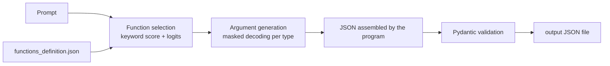

*This project has been created as part of the 42 curriculum by sgil--de.*

# Call Me Maybe

> Reliable function calling with a 0.6B LLM, using **constrained decoding** instead of free-form generation.

Given a list of functions (name, description, typed parameters) and natural-language prompts, the program
picks the right function and fills its arguments, and always outputs **valid JSON**, even with a very small
model (`Qwen/Qwen3-0.6B`).

```text
Prompt : "What is the sum of 265 and 345?"
Output : {"prompt": "What is the sum of 265 and 345?", "name": "fn_add_numbers", "parameters": {"a": 265, "b": 345}}
```

---

## Table of Contents

1. [Description](#description)
2. [How it works](#how-it-works)
3. [Instructions](#instructions)
4. [Example usage](#example-usage)
5. [Design decisions and performance](#design-decisions-and-performance)
6. [Testing strategy](#testing-strategy)
7. [Resources](#resources)

---

## Description

Small LLMs are bad at following an output format: left alone, they forget a quote, invent a field or answer in
prose. **Call Me Maybe** never lets the model write the structure itself. The program writes every JSON token
it already knows (`{`, `"name": "`, keys, quotes…) and only asks the model to choose where a real decision has to
be made: which function, and which value for each argument. At each of those steps, the logits are **masked** so
the model can only produce tokens that are valid at that position.

Result: the output is valid JSON by construction, and parsed into a Pydantic model (`FunctionCallingResult`).

## How it works



1. **Prompt building**: a system context lists every available function with its typed signature and description.
2. **Function selection** (hybrid):
   - the prompt is split with a regex, stop words are removed, and each function gets a score based on the words
     shared with its description;
   - if there is a clear winner, it is used directly;
   - otherwise, the model chooses, but only among the tied function names (restricted vocabulary).
3. **Argument generation**, depending on the declared type:
   - `string`: the opening quote is forced, then tokens are generated until the closing quote;
   - `number` / `integer`: the logits are masked so that only tokens made of `0-9`, `.` and `-` are allowed
     (this list of token ids is precomputed once from the vocabulary).
4. **Assembly and validation**: the JSON is built by the program and validated with Pydantic.

## Instructions

Requirements: Python ≥ 3.10 and [uv](https://docs.astral.sh/uv/).

```bash
make install   # install dependencies (torch, transformers, pydantic…)
make           # run with the default input files
```

With custom paths:

```bash
uv run python -m src \
  --functions_definition data/input/functions_definition.json \
  --input data/input/function_calling_tests.json \
  --output data/output/function_calling_results.json
```

| Flag | Default | Description |
| --- | --- | --- |
| `--functions_definition` | `data/input/functions_definition.json` | Available functions and their parameters |
| `--input` | `data/input/function_calling_tests.json` | Prompts to resolve |
| `--output` | `data/output/function_calling_results.json` | Where the results are written |

Other targets:

| Command | Description |
| --- | --- |
| `make debug` | Run under `pdb` |
| `make lint` | `flake8` + `mypy` |
| `make lint-strict` | `flake8` + `mypy --strict` |
| `make clean` | Remove caches and temporary files |

## Example usage

Add a function to `functions_definition.json`:

```json
{
  "name": "fn_get_weather",
  "description": "Get the current weather for a specific city.",
  "parameters": {
    "city": { "type": "string" }
  },
  "returns": { "type": "string" }
}
```

Then use it from Python:

```python
from src.parsing import Parsing
from src.model import Model

model = Model(Parsing())
print(model.resolve_prompt("Check the weather in Paris"))
```

Nothing in the code depends on specific function names: any well-formed definition file works.

## Design decisions and performance

- **The program writes the structure, the model makes choices.** This is what guarantees valid JSON even with a
  0.6B model.
- **Keyword scoring before the LLM.** Most prompts are resolved by the score alone, which is fast and
  deterministic; the model is only asked when there is a tie.
- **Precomputed numeric vocabulary.** The token ids allowed for numbers are computed once at startup instead of on
  every argument.
- **Generic by design.** No function name is hard-coded, so the same engine works with any function list.

## Testing strategy

- Changing the definition and prompt files to check that the right function and arguments are selected.
- Feeding invalid definitions (unknown types, malformed JSON) to check that errors are reported cleanly.
- `make lint` (flake8 + mypy) runs on every push through GitHub Actions.

## Resources

- [PyTorch documentation](https://docs.pytorch.org/tutorials/index.html)
- [Hugging Face Transformers](https://huggingface.co/docs/transformers)
- [Pydantic documentation](https://docs.pydantic.dev/latest/)
- [uv documentation](https://docs.astral.sh/uv/)

**Use of AI:** AI was used to answer questions about constrained decoding while learning the concept.
